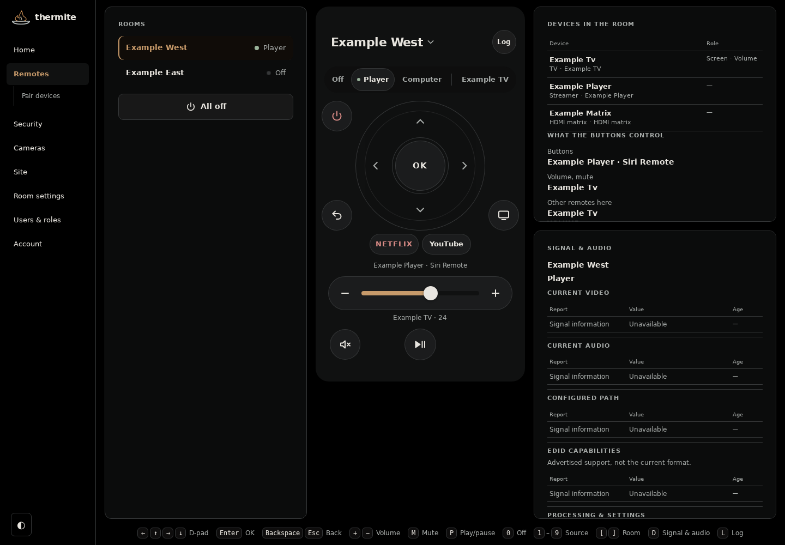
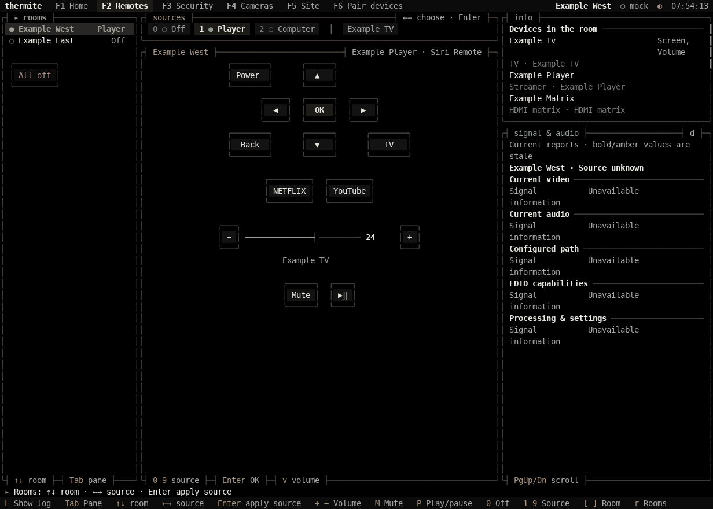

<picture><source media="(prefers-color-scheme: light)" srcset="docs/assets/torch-light.svg"></picture>

<h1 align="center">thermite</h1>

Home automation you can own.

Describe your rooms, devices and connections in one file. thermite builds your [openHAB](https://www.openhab.org/) configuration and gives you everyday controls in a web app and a terminal.

## See it

The web app: room and source selection, device controls, and signal information in one place.

The terminal remote uses the same controls and room model. Both screenshots show **demo mode with fictional inventory**, captured from the actual clients. [Capture recipe](https://spincyc.github.io/thermite/screenshots.html).

## What you get

- **One house file.** Rooms, devices and their connections stay together; thermite generates the runtime configuration.
- **Checked deployments.** Validate the configuration, check openHAB startup, and restore an earlier deployment with `thermite rollback`.
- **Controls on every screen.** Use your phone, desktop browser or terminal to choose sources and control devices.
- **Local control.** Core integrations communicate on your network. Optional cloud integrations use their providers' services.
- **Your own site.** Keep real inventory and generated configuration in private Git, separate from the application.

## Choose an installation

| Where thermite will run | Start here |
|---|---|
| An existing Linux server | [Server installation](https://spincyc.github.io/thermite/installation.html) |
| A dedicated machine | [Build and install the standalone ISO](https://spincyc.github.io/thermite/iso.html) |
| A development machine, with fictional devices | [Try the example](https://spincyc.github.io/thermite/start.html#try-the-example) |

This checkout contains the application and a fictional example. Keep your real house configuration in a separate private site; `thermite init` creates one. Installing the application and commissioning a running house are separate steps.

## Explore

- [Get started](https://spincyc.github.io/thermite/start.html): try the example, install, and connect your devices.
- [Commands](https://spincyc.github.io/thermite/commands.html): every command, with examples. `thermite help <command>` works in your shell.
- [Questions](FAQ.md): requirements, privacy and upgrades.
- [Colors](https://spincyc.github.io/thermite/colors.html): light and dark modes, accessible themes and the bowl mark.

Under active development, version `0.1.0.dev0`. All rights reserved.
