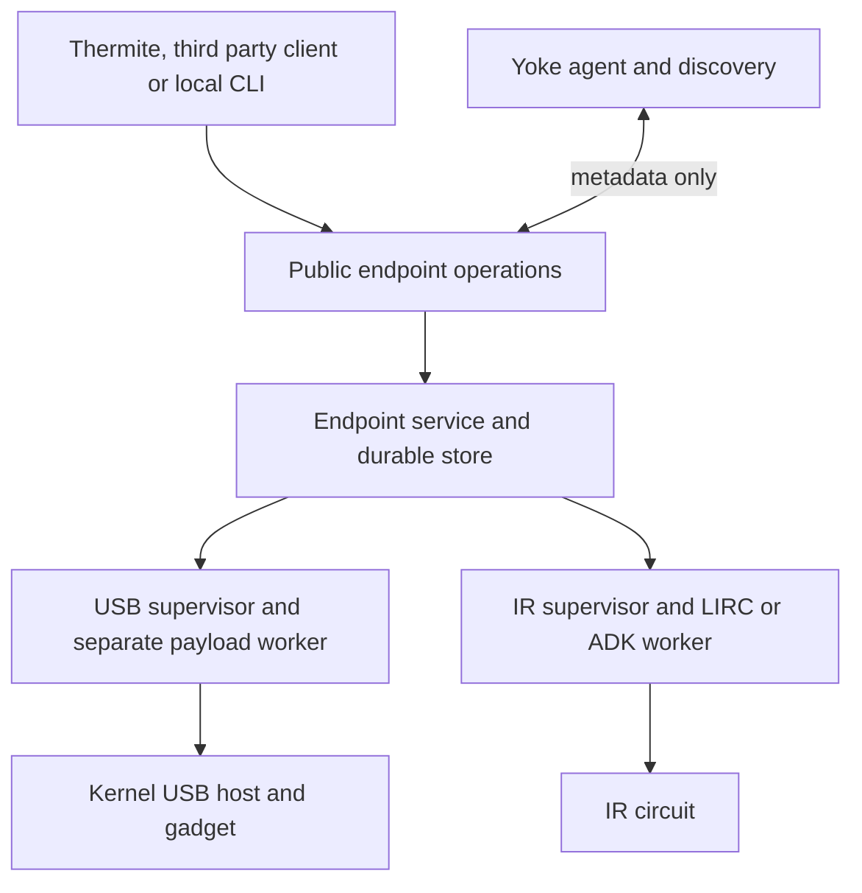

# Radxa ZERO 3E endpoint code design

> **Superseded in part, 2026-11-04.** Yoke implemented its endpoints
> differently from this proposal. Where they differ, Yoke's decisions
> govern ([design](https://github.com/spincyc/yoke/blob/main/doc/design/USB-DATAPATH.md),
> [review dispositions](https://github.com/spincyc/yoke/blob/main/doc/research/REVIEW-2026-11-04.md)).
>
> | Topic | This proposal | Decided instead |
> |---|---|---|
> | IR | LIRC on the Radxa, optional Mega | A standalone ESP32 PoE endpoint with RMT output and an opt-in Global Caché iTach subset on TCP 4998 (Yoke ADRs 0025/0026). Rockchip `pwm-ir-tx` uses an inaccurate sleep path, and ADK's Mega code is NEC-only at 38 kHz |
> | Computer-side USB output | vhci import, then libusb, then GadgetFS | A userspace USB/IP client feeding Raw Gadget in a separate worker, with no vhci import (ADRs 0021/0022) |
> | Computer-side power | PoE | Powered by the computer through the OTG port, with no HAT |
> | Data-plane admission | — | Producers admit USB/IP sessions only from authenticated paired consumers (ADR 0024) |
>
> For Thermite, its Global Caché integration accepts only a genuine iTach
> IP2IR, so it needs a model allowance before it can drive a Yoke IR
> endpoint.

Proposal, 2026-11-02. Build the standalone hardware runtime in **Yoke**;
Thermite supplies an optional integration. Each ZERO 3E can run IR and USB
services together. Pairing survives power loss and network outages, and
endpoints reconnect directly without Thermite or another manager.

The largest development risk is presenting an arbitrary remote USB device
through the Radxa's physical USB port. Existing Yoke code imports USB/IP into
Linux; it does not implement that final step. Prove physical USB forwarding
before investing in a polished enclosure or broad device support.

## Recommended scope

| Component | Implementation | First acceptance criterion |
| --- | --- | --- |
| Endpoint control | Extend Yoke's Python core, CLI, discovery and simulations | Pair, reboot and reconnect with every external manager absent |
| USB transport | Linux USB/IP inside a direct authenticated peer tunnel | Selected control, bulk and interrupt devices work on a Linux reference client |
| Physical USB output | Separate native libusb and Linux gadget worker | A remote device enumerates and works on the actual target computer |
| IR | LIRC backend, plus an optional ADK Mega coprocessor | Verified codes transmit correctly during simultaneous USB traffic |
| Existing IR installation | Electrically qualified input, physical bypass and injection circuit | Existing controls still work with the Radxa powered off |
| Thermite integration | Client of the published endpoint interface | Removing Thermite leaves the saved routes operational |

Keyboard and mouse emulation is a useful bring-up test. It is **not** the
generic USB2 deliverable. The first USB2 release needs a named compatibility
list; flight controls, vendor-specific devices and composite devices cannot
be inferred to work from a keyboard demonstration. Qualify isochronous audio
and video separately. USB2 High-Speed means 480 Mbps signaling, not guaranteed
480 Mbps application throughput.

## Repository and process boundaries

Keep Yoke independently installable and preserve its MIT control library.
Keep AVR firmware in ADK. Thermite depends on their public contracts, and
neither project imports Thermite's inventory, openHAB configuration, UI or
deployment machinery.



The endpoint service owns applied routes, device access and recovery. The
Yoke agent drives it through a metadata-only driver. USB bytes bypass
Thermite. USB bytes and IR waveforms never traverse `yoke.core` or multicast
control frames; authorized clients may submit waveforms directly to the IR
service.

Stopping a management client does nothing to the route. Restarting a local
hardware worker may interrupt service; the saved pairing remains intact.

One endpoint store is authoritative. The agent submits operations and
observes results; it must never restore its own stale pairing over a newer
endpoint revision. Transaction decisions live in the pure core instantiated
by the endpoint service; `endpoint/pairing.py` supplies I/O and recovery.

Proposed additions in Yoke, alongside the existing packages:

```text
src/yoke/core/                  extend pure protocol and operation machines
src/yoke/net/runner.py          persistence results and generation fencing
src/yoke/drivers/endpoint.py    metadata-only endpoint client
src/yoke/endpoint/
  service.py                   local operations and worker supervision
  store.py                     versioned SQLite schema and migrations
  pairing.py                   transaction recovery and admission decisions
  inventory.py                 stable selectors and capability probes
  usb.py                       desired-route reconciliation, no payload
  ir.py                        job metadata, limits and backend selection
  rpc.py                       documented local requests and responses
  cli.py                       JSON interface for humans and other managers
native/usb-proxy/               libusb to gadget data worker
firmware/                      manifests referencing ADK builds
packaging/zero3e/               packages, units, udev rules and overlays
doc/design/ENDPOINT-API.md      schemas, errors, permissions and examples
```

Retain Python >=3.12 and stdlib-only Python runtime imports. Native workers
have separately declared system dependencies, such as libusb. Keep driver
commands as typed arguments; never accept arbitrary shell commands through
the endpoint API. A narrow privileged helper owns configfs and device
binding; the control agent runs without root privileges.

## What to reuse and what to correct

Yoke baseline: local unpublished commit
`10ab5d405e3837dc52278cfcabfb05244aa8c800`. Paths in this table are relative
to that checkout. These findings describe inspected code, not board tests.

| Existing code | Reuse or required change |
| --- | --- |
| `core/node.py`, `core/frames.py` | Preserve explicit inputs, effect outputs, bounded framing, version ordering and deterministic tests. Extend the state machines for USB ownership. |
| `net/mcast.py`, `cli.py`, `snoop.py` | Reuse discovery, diagnostics, CLI conventions and passive observation. Discovery must not grant access. |
| `statefile.py`, `core/types.py` | Reuse atomic-write concepts. Current persisted state only records sequence and consumer pairing; add durable endpoint configuration, schema migration and operation results. Atomic file replacement also needs parent-directory synchronization for power-loss durability. |
| `net/runner.py::_persist` | **Fix before relying on persistence:** it catches save failures, then execution continues to attach and acknowledge. `tests/test_runner.py::test_persist_failure_keeps_agent_running_and_acking` currently requires that behavior. |
| `core/node.py::_apply_pair` | A new attach can occur without detaching the old route. Replace this with serialized reconciliation and explicit fencing of the previous generation. |
| `drivers/usbip.py` | Keep command parsing and mocked transcripts. Attach currently imports into the local Linux stack; it provides no physical OTG presentation. |
| USB/IP attach and detach | Reconcile only owned imports; current detach removes every imported port. Roll back partial attaches, make retries idempotent and verify actual export readiness. The advertised port is currently validated but ignored. |
| Producer lifecycle | Bind and unbind currently follow agent lifetime. Move route ownership into the independently supervised endpoint service. |
| Runner driver work | Implement the documented single executor and generation-tagged statuses. Cancelling an asyncio task does not stop an already running worker thread. |
| `tests/simnet.py` and scenario tests | Extend these for partitions, conflicts, crashes, storage errors and transaction recovery. Preserve offline reproducibility. |

The current YWP/1 protocol has passive producers and independently owned
consumer pairings. USB exclusivity is delegated to USB/IP refusing a second
connection. That is insufficient for deliberate reassignment while an old
consumer is still connected. YWP/1 also uses a site-wide HMAC key, and replay
handling depends on wall-clock-derived sequence numbers. Its protocol text
describes a seconds-based floor while ADR 0007 and the implementation use
nanoseconds; reconcile that discrepancy before implementing another client.

Use existing YWP/1 for a trusted bench baseline. Before shipping the hardware
profile, write an ADR and specify **YWP/2** for authenticated
resource ownership and durable operation outcomes. Do not silently reinterpret
YWP/1. Field resources reject YWP/1 mutations, including relayed cached
intents, and never downgrade automatically. Lamport ordering remains useful
in v1; v2 USB ownership uses authorized operations with revision preconditions.
Retain multicast for discovery and observation; established peer sessions
can reconnect using configured addresses or resolvable names when multicast
is unavailable. If DHCP changes an address and every configured discovery
path fails, report `peer_offline` and retain pairing until the peer becomes
locatable.

Make persistence completion an explicit state-machine input. The core must
not mark a new operation committed until the store reports success; merely
suppressing the first acknowledgment would leave a duplicate request able
to receive a false "already applied" success. Add generation-tagged driver
completion inputs for the same reason. Keep these decisions in the pure
core, with SQLite and worker I/O in adapters.

Replace wall-clock-derived replay authority with authenticated boot/session
epochs and durable operation revisions in the new profile. A same-second
restart can currently reuse transmitted startup sequence numbers, and
receive replay marks are volatile. Passive snooping remains useful for
diagnosis, but authenticated endpoint queries become authoritative when
transactions move to private peer channels.

ADK baseline: commit `77f6c343184863b2b8fda3727923b95145af2b9e`.
Reuse its pin and timer ownership, explicit update calls, NEC decoding rules,
repeat handling and deterministic host tests. Its
[transmitter](https://github.com/spincyc/adk/blob/77f6c343184863b2b8fda3727923b95145af2b9e/src/adk/ir_transmitter.cpp)
is fixed at 38 kHz and sends NEC or extended NEC using AVR Timer3; its
[receiver](https://github.com/spincyc/adk/blob/77f6c343184863b2b8fda3727923b95145af2b9e/src/adk/ir_receiver.cpp)
is a NEC decoder, not a general waveform recorder. General raw capture,
configurable carrier frequency and buffered transmission are new firmware
work. Keep AVR register code on the
Mega. ADK's latest-value Bridge can coalesce events, so it is unsuitable for
transporting USB events or a reliable queue of IR commands.

## Durable pairing and recovery

Represent a physical board separately from its logical resources. A board
may expose a USB peripheral group, a computer-facing gadget and an IR port
without sharing one pairing record. Select USB devices by an enrolled
physical port and descriptor identity, with serial number where available;
VID/PID alone and transient USB bus numbers are insufficient. Never export
every newly attached device automatically. Exclude the local Mega's serial
connection from USB export.

Store device identity, locally enrolled operator keys, per-resource revision,
peer identity, pairing ID, selected profile, reconnect hints, pending
operations and revocations. Use one authoritative SQLite writer, with WAL
and `synchronous=FULL`; heartbeat and report traffic must not cause durable
writes. Actual durability depends on the storage honoring
synchronization. [SQLite durability settings](https://www.sqlite.org/pragma.html#pragma_synchronous).

Distinguish first commissioning from missing state on an already commissioned
device. A missing database must not silently turn that device into a fresh
unpaired endpoint.

| Configuration or transaction state | Behavior |
| --- | --- |
| `UNPAIRED` | No peer admitted |
| `PREPARED` | Authorized candidate saved; old configuration retained; candidate has no access |
| `COMMIT_DECIDED` | Peripheral source has fenced the old session and durably chosen the new owner; delivery to the consumer may still be pending |
| `PAIRED` | Saved peer and resource authorization remain until an explicit operation changes them |
| `REVOKED` | Local transport fenced; durable notification retried until confirmed by the former peer |
| `RECOVERY_REQUIRED` | Corrupt or incompatible state blocks transport; no silent reset or automatic adoption |

Operational state is separate: `peer_offline`, `device_absent`,
`connecting`, `enumerating`, `active` or `fault`. Neither a timeout nor a
management client's disappearance changes the configured peer.

For an exclusive USB group, the peripheral source is the decision authority
for its own devices. The computer-side endpoint authorizes its own gadget.
Pair and re-pair use an immutable operation ID, request digest, both expected
resource revisions and authorization at both endpoints:

1. The consumer durably prepares the exact candidate and returns a receipt.
2. The source verifies that receipt and fences the previous worker. Cancel
   or drain outstanding USB work; a new owner cannot coexist with executable
   work from the old generation.
3. The source durably commits the new pair, generation and old-pair
   revocation. Only then does it send a commit decision.
4. The consumer fences its previous route, commits the matching pair and
   acknowledges. Both endpoints recover this exchange directly if the
   initiating client has exited.
5. Admit data only after a fresh authenticated session proves matching
   pair IDs, resource revisions and fresh boot/session nonces at both ends.

These are application transaction semantics to specify and simulate, not
guarantees supplied by TCP, SSH or HTTP. A lost acknowledgment never restores
an old owner. Pending preparation requires an explicit abort or superseding
operation; it does not expire into an automatic unpair. Serialize conflicting
operations per resource. Verify preparation and decision records directly
through the authenticated peer channel; bind each to the exact operation,
identities and revisions. An abort is a durable conditional decision at the
source before commit. An unreachable source does not prove an operation
has not committed.

Explicit unpair immediately fences local access, then durably records the
revocation. Report persistence failure as failure, even if local data has
already stopped. When the peer is unreachable, report local effectiveness
and remote confirmation separately. Source-side fencing prevents the old
consumer receiving new device traffic; it cannot force an unreachable
consumer to disappear from its computer's USB device list.

Use pinned device identities, independently enrolled operator permissions
and fresh session challenges. Pairing authority must not depend on NTP,
Internet access, a certificate service or a renewable management lease.
Neither discovery nor possession of a group observation key authorizes a
route change. Restoring an old disk image or cloning an identity cannot be
reliably detected without an independent monotonic trust anchor; do not
claim storage rollback protection.

## USB backends

Define separate source and presentation interfaces. The source provides
inventory, claim, release, reset and capability information. Presentation
provides descriptor validation, bind, unbind and health. A supervisor joins
them with a saved route and session generation. Payload workers handle the
transfers; the control plane receives only status.

| Backend | Role and limits |
| --- | --- |
| `usbip-linux` | Existing kernel export/import path and reference test mode. Requires a USB/IP client on the target computer. |
| `hid-gadget` | Fixed keyboard/mouse descriptors via configfs and `/dev/hidgX`. Validates the physical output path; handle LED output, held keys, loss of input state and neutral reports on failure. |
| `usb2-proxy` | Proposed generic path: USB/IP import through `vhci-hcd`, native libusb access, then physical GadgetFS presentation. Feasibility must be established on the ZERO 3E UDC. |

Linux documents USB/IP as importing devices into the client's USB stack;
the driver runs on that client. It does not turn an OTG port into a remote
device automatically. [USB/IP protocol](https://docs.kernel.org/usb/usbip_protocol.html).

The generic proxy must handle EP0 control requests, configurations, alternate
settings, endpoint stalls, clear-halt, cancellation, reset, short packets
and zero-length packets. Reject unsupported descriptor and endpoint
combinations explicitly. Begin with one selected device, possibly composite,
per physical gadget. Arbitrary hubs and multiple unrelated devices are
additional work; combining interfaces does not reproduce a hub topology.

Inspect existing open proxy implementations during feasibility, rather than
assuming a new USB stack is necessary. The
[Nesto USBProxy fork](https://github.com/nesto-software/USBProxy) uses libusb
and GadgetFS, but documents Raspberry Pi 4 armhf scope and shutdown/hotplug
issues; it is a GPL-2.0 candidate for a separately distributed worker, not a
verified Radxa backend. The kernel calls
[Raw Gadget](https://docs.kernel.org/usb/raw-gadget.html) a debugging feature
unsuitable for production. It can support experiments, not the shipping
backend contract.

A fixed kernel [HID gadget](https://docs.kernel.org/usb/gadget_hid.html) can
remain enumerated during network loss. Node reboot, gadget changes and
generic-device switching may cause re-enumeration. Do not promise that every
USB backend behaves like fixed HID.

## IR backends and coexistence

Normalize IR as carrier frequency, duty cycle and a bounded sequence of
marks and spaces in microseconds, with explicit repeat segments and gaps.
Keep protocol decoding optional. A demodulating optical receiver captures an
envelope and normally cannot establish the original carrier frequency.
Publish that limitation in capture results.

The native backend uses Linux LIRC device capabilities and stable udev names.
LIRC pulse writes begin and end with a mark and block through transmission;
use a dedicated serialized worker and a bounded queue.
[LIRC transmission contract](https://docs.kernel.org/userspace-api/media/rc/lirc-write.html).
Validate Global Cache profile conversion carefully: carrier-cycle durations,
repeat offsets and final spaces must retain their meaning in the microsecond
representation.

For the ADK backend, load and validate the complete waveform before starting
the timer. Add a versioned serial protocol with bounded framing, checksum,
operation ID, `accepted`, `started`, `completed`, `busy` and error responses.
Queue complete commands rather than coalescing values. A serial reconnect
must not replay an uncertain transmission. Record such a result as
`outcome_unknown`; exactly-once physical IR execution across a power failure
cannot be guaranteed by a network acknowledgment.

Use native LIRC for initial bring-up, then measure carrier and envelope
timing under USB and network load. Hardware PWM provides a carrier but does
not prove accurate Linux envelope scheduling. Use the Mega coprocessor when
the native backend fails the required timing envelope. Its timer-driven raw
waveform and capture extensions must also be measured; the existing blocking
NEC transmitter is not already that implementation.

For installation beside Control4, a software capture-and-replay loop alone
does not provide uninterrupted passthrough. Use an electrically compatible
physical bypass that defaults to connecting input to output without Radxa
power, plus qualified sensing and injection circuitry. Do not tie two active
outputs together. Define arbitration when legacy IR and a new command arrive
together, and prevent retransmission loops. Optical receiver modules are not
automatically compatible with a wired emitter output. Confirm jack size,
pinout, voltage, polarity and carrier/baseband behavior before choosing the
electrical profile; the description "8 mm jack" does not define these.

## Public operations and trust

For the prototype, use documented JSON requests through a local Unix socket
and an OpenSSH forced-command adapter. This avoids writing a new HTTP or TLS
server in the stdlib-only agent. Use JSON-RPC 2.0 envelopes, one UTF-8 JSON
object per line, with a 64 KiB message limit and versioned method names.
Publish schemas, error codes, authorization, exit codes and conformance
fixtures. Enroll peer and operator
keys locally; generate no fleet-wide default credentials. The peer adapter
binds its authenticated identity and session generation before admitting
USB/IP, which remains inaccessible directly from the LAN.

Map SSH credentials to local principals rather than trusting a caller's
claimed role in JSON. Use a separately constrained peer channel for the
binary USB stream. Account explicitly for the stock USB/IP client's port
behavior, for example with an isolated network namespace and loopback
forwarding; do not treat the currently ignored port field as working support.

A later HTTPS/OpenAPI adapter can expose the same handlers. It adds a
transport, not another source of route state or privileged management path.
Thermite, local CLI and third-party clients have the same permissions.

| Operation | Contract |
| --- | --- |
| Capabilities and inventory | Board/kernel/backend versions, physical resources, supported profiles, timing limits and actual USB speeds |
| Pairing read | Saved configuration, revision, pending operation and separate operational state |
| Pair, re-pair, unpair, abort | Immutable operation ID, expected revisions and durable result; duplicate requests return the recorded result |
| Operation read | Resolve an ambiguous response without executing the operation again |
| IR transmit | Validated waveform/profile, request ID and bounded queue; acceptance differs from completion |
| IR capture and job read | Explicit duration/size limits, overflow indication, completion or unknown outcome |
| Events and diagnostics | Bounded metadata, state transitions and errors; payload recording requires an explicit diagnostic operation |

Reuse of an operation ID with different content is a conflict. A stale
revision cannot change a newer configuration. Peer credentials permit
participating in an authorized route and revoking one's own consent; they
do not permit pairing another endpoint to an arbitrary third party.
Publish every listener, update path, reset operation and privilege. No
vendor override key, hidden diagnostic shell, automatic cloud enrollment
or undocumented fallback pairing is part of the design.

## Thermite integration

Add an endpoint integration through the public contract. Reuse the verified
profile and provenance rules in
[globalcache_ir.py](../lib/oh_integrations/globalcache_ir.py) and the
[IR profile CLI](../lib/oh_cli/ir_profile.py), while adding a separate
endpoint transport. The current integration deliberately identifies an
iTach IP2IR and a Sony player; do not falsely identify the Radxa as an iTach
or relax those checks to make a prototype fit. Transmission completion is
not an observation of player power or playback state.

Extend the routing model with explicit USB endpoint resources and pairing
status. Existing
[USB matrix integration](../lib/oh_integrations/ukm404_http.py) and
[room routing](../lib/oh_features/routing/__init__.py) provide useful client
seams, but numerical matrix ports alone do not represent distributed
resources. Display configured route, pending/enumerating state and actual
backend health separately. Real unpair replaces the matrix convention of
parking a route on an uncabled host. Thermite must not continually overwrite
a route changed by another authorized client; revision conflicts surface
for reconciliation.

## Installation and board qualification

This is a Linux image and package installation, not an Arduino sketch flash.
Start with Radxa's tested Bookworm/kernel 6.1 image and record its checksum,
kernel, device tree and package manifest.
[Radxa images](https://docs.radxa.com/en/zero/zero3/download).
Check Python >=3.12 explicitly; provide a pinned private runtime when the
image's interpreter is older, without replacing the system interpreter.

Install versioned offline-capable packages containing Yoke, the endpoint
service, native workers, board overlays, udev rules and systemd units. Save
identity and configuration under `/var/lib/yoke`, outside release files.
Provision resource roles and operator trust locally, enroll peers, then let
the client exit. Generate a unique device identity on each board; never bake
host keys or a fleet identity into the image. Updates are explicit, preserve
configuration and retain a compatible previous release; schema migrations
must define rollback limits.
No update server or Internet connection is required for operation.

The optional Mega runs a new coprocessor sketch built with ADK's C++23 AVR
toolchain or ADK Boards package. Upload its compiled image through the normal
Mega bootloader using `arduino-cli`, then identify the serial port by a stable
udev name. Firmware and Linux package manifests record their compatible
serial protocol versions; neither component silently flashes the other.

| Board gate | Evidence required before claiming support |
| --- | --- |
| USB roles | Peripheral on USB3 host port; computer on USB2 OTG port; simultaneous operation verified |
| USB gadget ownership | Detect UDC and endpoint limits; explicitly disable conflicting NCM/ADB gadget setup during provisioning |
| USB2 speed | Actual High-Speed link and computer-side `480M` enumeration for a High-Speed test device; benchmark useful throughput |
| IR | Board-specific overlay and circuit validated, then timing measured while USB is active |
| Power | Qualified 5 V PoE PD/splitter accessory and power path, including USB VBUS/backfeed behavior and peripheral load |
| Recovery | Power interruption at durable commits, network loss, changed addresses and manager-free reboot |

Radxa documents the host/OTG interfaces, 5 V power and 3.3 V GPIO limits in
its [hardware interface guide](https://docs.radxa.com/en/zero/zero3/hardware-design/hardware-interface).
Its [USB networking instructions](https://docs.radxa.com/en/zero/zero3/radxa-os/usbnet)
also show competing gadget configurations that provisioning must account
for. These documents do not establish compatibility of the proposed proxy.

Start the native IR board profile with physical pin 7, GPIO3_C4/PWM14_M0,
for transmit; physical pin 11, GPIO3_A1, is a receive candidate subject to
pin ownership checks. Radxa supplies a
[PWM14 overlay](https://raw.githubusercontent.com/radxa/overlays/main/arch/arm64/boot/dts/rockchip/overlays/rk3568-pwm14-m0.dts)
for this pin. Add the matching `pwm-ir-tx` and `gpio-ir-receiver` consumers
in a board overlay, then discover LIRC devices by capabilities. The IR jack
connects through the qualified driver/sensing circuit, not directly to GPIO.

## Implementation sequence

1. **Board feasibility first.** On one Radxa, prove physical gadget output,
   local generic proxy behavior and IR timing. Use a Linux computer as the
   USB/IP reference client. Two Radxas are needed for the complete physical
   USB endpoint pair; the two Mega kits supply IR coprocessors, not a
   replacement for the Radxa gadget endpoint.
2. **Correct Yoke durability and driver behavior.** Add deterministic
   regressions for save failure, partial attach, ownership-scoped detach and
   stale driver completion. Change the normative protocol and add ADRs
   before implementing changed behavior.
3. **Standalone pair prototype.** Implement durable operations, direct peer
   recovery and session fencing; exercise with Thermite entirely absent.
   Add HID as a diagnostic milestone and the qualified generic proxy as a
   separate acceptance gate.
4. **IR and coexistence.** Validate known codes, raw learning limits, queue
   outcomes and simultaneous traffic; test legacy control with Radxa power
   removed before installing inline.
5. **Thermite adapter and release packaging.** Add inventory/routing support,
   repeat the public API tests with an independent client, and publish the
   tested hardware/device matrix.

Prioritize simulations of power loss before every acknowledgment, competing
re-pairs, a partition from the previous consumer, delayed old operations,
full/corrupt storage, wrong clocks and a management client disappearing
mid-operation. Hardware qualification adds unplug/replug, USB resets and
stalls, held HID keys, IR queue overflow and concurrent USB/IR load.

Planning estimate: allow 1–2 focused weeks for board and proxy feasibility,
then roughly 3–6 weeks for a bounded standalone pairing, HID and IR
prototype. Generic physical USB qualification can add months, depending on
the required device list. The feasibility result should determine that
commitment; software changes alone cannot remove a UDC hardware limitation.
